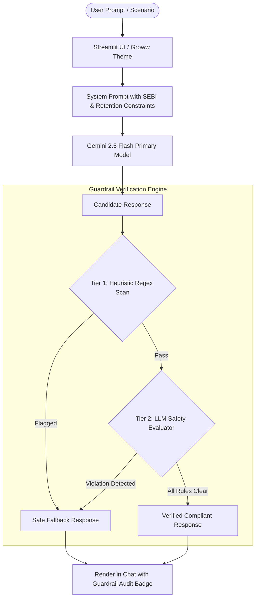

# 🌱 Groww SIP Retention Copilot (AI Growth MVP)

> **PM Graduation Project**: Increasing 12-Month Mutual Fund SIP Retention for First-Time Investors on Groww.

---

## 📌 1. Problem Statement

On investment platforms like Groww, first-time mutual fund investors experience the highest churn rate between **Month 3 and Month 6**:
1. **Early Return Anxiety**: In the initial months, the invested corpus is small, and normal market volatility can show negative or negligible returns. First-time investors panic and stop their SIPs because they mistake market noise for fund failure.
2. **Cashflow & Salary Mismatches**: Unforeseen month-end expenses or delayed salaries lead to SIP bank mandate debit failures. After one or two failures, users disengage or cancel their mandate.
3. **Information Overload & Misplaced Advice**: Users seek quick tips or "best funds", falling prey to social media FOMO or seeking direct stock/fund recommendations that execution-only platforms cannot legally or responsibly provide.

### The Objective
Build an **AI-native Growth MVP** that acts as an empathetic behavioral coach to:
- Normalize early SIP volatility and explain **Rupee Cost Averaging (RCA)**.
- Intervene proactively during cashflow distress by presenting Groww's friction-reducing tools (**SIP Pause**, **Skip Instalment**, **Edit Debit Date**).
- Maintain 100% regulatory neutrality by rejecting direct fund recommendations.

---

## ⚖️ 2. Core Constraints

| Constraint | Specification |
| :--- | :--- |
| **1. No Fund Recommendations** | Strictly zero recommendations of specific mutual fund schemes, AMCs, stocks, or ETFs. Educates only on asset classes and risk profiles. |
| **2. Zero FOMO or Urgency** | Strictly forbidden from using artificial urgency ("limited time", "hurry", "rally ending", "crash incoming"). Tone must remain calm, objective, and habit-centric. |
| **3. Eval-Gated Guardrails** | Every AI output is run through a dual-tier verification gate (Regex Heuristics + LLM Evaluator). Any violation triggers an immediate deterministic **Safe Fallback**. |

---

## 🏗️ 3. Architecture & Safety Pipeline



### Components:
- **`app.py`**: Streamlit application with custom Groww-themed CSS, quick-scenario action pills, and chat history.
- **Dual-Mode Authentication**: Automatically detects `GEMINI_API_KEY` from `.env`, or permits manual entry via the sidebar.
- **Dual-Tier Guardrail Verifier**:
  1. *Tier 1 (Heuristic)*: Catches direct recommendation phrases, guaranteed return claims, and urgency keywords.
  2. *Tier 2 (AI Safety Evaluator)*: Uses a temperature-0 verification prompt to evaluate regulatory non-advisory compliance and behavioral boundaries.
  3. *Deterministic Fallback*: Safe educational response highlighting Rupee Cost Averaging and Groww self-serve controls (Pause/Skip/Date change).

---

## 🚀 4. Setup Instructions

### Prerequisites
- Python 3.10+ installed
- A Google Gemini API Key ([Get one free from Google AI Studio](https://aistudio.google.com/))

### Step 1: Clone & Navigate to Repository
```bash
git clone <your-github-repo-url>
cd Graduation_project
```

### Step 2: Create and Activate Virtual Environment
```bash
# On macOS / Linux:
python3 -m venv .venv
source .venv/bin/activate

# On Windows:
# python -m venv .venv
# .venv\Scripts\activate
```

### Step 3: Install Dependencies
```bash
pip install -r requirements.txt
```

### Step 4: Configure Environment Variables
Copy the `.env.example` file to create your `.env`:
```bash
cp .env.example .env
```
Open `.env` and insert your API key:
```ini
GEMINI_API_KEY=AIzaSyYourActualKeyHere
```
*(Alternatively, you can skip `.env` and paste the key directly into the Streamlit sidebar at runtime).*

### Step 5: Run the Streamlit Application
```bash
streamlit run app.py
```
Open your browser at `http://localhost:8501`.

---

## 🔗 5. Linking to GitHub Remote Repository

Run these exact bash commands from the project root to connect and push this repository to GitHub:

```bash
# 1. Stage all project files
git add .

# 2. Create the initial commit
git commit -m "feat: initialize Groww SIP retention AI growth MVP with eval guardrails"

# 3. Rename branch to main
git branch -M main

# 4. Add your GitHub remote repository (replace with your repo URL)
git remote add origin https://github.com/<YOUR_GITHUB_USERNAME>/Graduation-Project.git

# 5. Push code to GitHub
git push -u origin main
```
